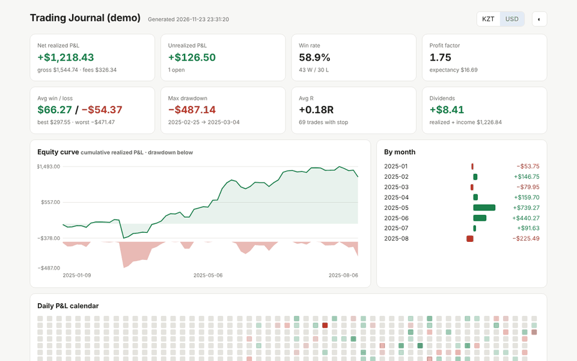

# Trading Journal for AI agents

**An exact, local-first trading journal your AI agent can drive.** Tell Claude Code,
Codex or Cursor "I bought 10 NVDA at 118.40, stop 109" or hand it a broker export,
and ask "how did my swing trades do this quarter?". The agent records and asks;
a deterministic ledger in a local SQLite file does all the math.

LLMs are bad at trade arithmetic: average prices after partial sells, fees,
shorts, option multipliers, splits, several currencies. This tool exists so the
model never has to do it.

- **Exact P&L** — average-cost ledger in `Decimal`, entry and exit fees, partial
  closes, shorts and flips, option multipliers, splits, dividends, per-currency
  totals. Edit or back-date any fill and everything is recomputed.
- **Built for agents** — every command speaks JSON (`trade --json ...`), errors are
  structured, imports are idempotent. Ships as a Claude Code plugin/skill and with
  `AGENTS.md` for other agents.
- **Imports** — any broker CSV, XLSX or JSON with columns auto-detected (including
  non-English headers): Interactive Brokers (Flex and Activity Statement), Trading 212,
  Binance, Schwab-style option histories, or JSON the agent builds from an exchange API.
  FX conversions are not booked as positions, options get their ×100 multiplier,
  expirations close at 0, and broker dividends and splits become events.
- **Journal** — thesis, stop and targets per trade, post-trade reviews, mood/mistake
  notes, tags (`ai-idea` vs manual performance), R-multiples.
- **Interactive dashboard** — one self-contained offline HTML file: equity curve and
  drawdown, monthly P&L, calendar heatmap, breakdowns, R distribution, positions
  with stops, filterable trade table.
- **Obsidian** — daily notes and one note per ticker with Dataview-friendly frontmatter.
- **Private** — no account, no SaaS: the database never leaves your machine; your agent
  only sees what it asks the CLI for.



<sub>Demo data. Static screenshot: [light](docs/dashboard.png), [dark](docs/dashboard-dark.png).</sub>

## Install

### As a Claude Code plugin

```text
/plugin marketplace add MaximSinyaev/obsidian-trading-tracker
/plugin install trading-journal@trading-journal
```

Then just talk to Claude about your trades. The skill installs the CLI on first
use if it is missing (via `uv`).

### The CLI (for any agent or for yourself)

```bash
# with uv (https://docs.astral.sh/uv/)
uv tool install "obsidian-trading-tracker[yahoo] @ git+https://github.com/MaximSinyaev/obsidian-trading-tracker@v1.0.0"
# or pipx
pipx install "obsidian-trading-tracker[yahoo] @ git+https://github.com/MaximSinyaev/obsidian-trading-tracker@v1.0.0"

trade --version
```

The `yahoo` extra adds optional Yahoo Finance quotes and FX rates. Without it the
tool has no network access at all; prices can be set by you or your agent.

### Codex, Cursor and other agents

Both read skills from `~/.agents/skills/` (all projects) or `.agents/skills/`
(one project), so one copy serves both:

```bash
git clone --depth 1 https://github.com/MaximSinyaev/obsidian-trading-tracker /tmp/ttt
mkdir -p ~/.agents/skills && cp -r /tmp/ttt/skills/trading-journal ~/.agents/skills/
```

In Codex call it with `$trading-journal`, in Cursor with `/trading-journal`, or
just talk about your trades. Other agents: give them [`AGENTS.md`](AGENTS.md).
Details, updating and troubleshooting: [docs/install.md](docs/install.md).

## Quick start

```bash
trade add AAPL buy 10 150 -c 1 --sl 140 --strategy swing --notes "Breakout above 148"
trade add AAPL sell 4 165 -c 1          # partial close → realized P&L printed
trade price set AAPL 158                 # or: trade price fetch (Yahoo)
trade positions
trade stats
trade review 2 --lesson "Took profits too early" --rating 4
trade dashboard -o dashboard.html --open
```

Import a broker export instead of typing:

```bash
trade import trades.csv --dry-run        # see detected columns and skipped rows
trade import trades.csv
trade import flex.csv --preset ibkr      # Interactive Brokers Flex Query or Activity Statement
```

Sample files are in [`examples/`](examples/). Optional presets for regional brokers
(`freedom`, `tinvest`) are listed in [`references/import.md`](skills/trading-journal/references/import.md).

**Average cost, not FIFO.** P&L uses the average-cost method. Brokers that report
FIFO lots, and tax statements in many countries, can show a different split
between realized and unrealized P&L for the same trades (the total over a closed
position is identical). FIFO is on the roadmap.

## Commands

| Area | Commands |
|---|---|
| Fills | `add`, `edit`, `delete`, `show`, `history [--closed]`, `review` |
| Positions & prices | `positions [--live]`, `price set/list/fetch` |
| Analysis | `stats [--from --to --ticker --strategy]`, `report` (JSON snapshot), `dashboard` |
| Journal | `journal add/list/delete` |
| Corporate actions | `event split`, `event dividend`, `event list/delete` |
| Import / export | `import`, `sync export` (Obsidian) |
| Maintenance | `db path/init/validate/rebuild`, `fx rate/convert/matrix` |

Add `--json` before any command for machine-readable output
(`trade --json positions`). Full reference with response fields:
[`skills/trading-journal/references/cli.md`](skills/trading-journal/references/cli.md).

## How P&L is computed

Average-cost method, the same one most retail brokers report:

```
Buy 10 @ 150, fee 1            → long 10 @ 150, open fees 1
Sell 4 @ 165, fee 1            → gross 4 × (165 − 150) = 60
                                  net = 60 − 0.40 (4/10 of entry fee) − 1 = 58.60
                                  remaining long 6 @ 150 (breakeven 150.10)
```

- Buying more re-averages; selling never changes the average; a flat position resets.
- Shorts mirror longs; a fill that crosses zero closes and opens in one step.
- Options/futures: set `--multiplier` (100 for US equity options).
- Splits adjust quantity and price; dividends are income, reported separately.
- Each currency is reported on its own; nothing is silently converted.

Every metric is defined in
[`references/metrics.md`](skills/trading-journal/references/metrics.md). The
test-suite checks hand-calculated cases, broker statements and randomized
invariants (once a book is flat, realized P&L equals cash flow minus fees).

## Configuration

Optional `.traderc.toml` in the current directory or your home directory:

```toml
[database]
path = "~/trading/trades.db"     # default: ~/.trading-journal/trades.db

[defaults]
commission = 0.0

[obsidian]
vault_path = "~/Notes"
trading_folder = "Trading"

[fx]
base_currency = "USD"
```

Environment overrides: `TRADE_DB=/path/to/trades.db`, `TRADE_CONFIG=/path/to/config.toml`,
or `trade --db PATH ...`. An existing `./trades.db` in the current directory is
still picked up when nothing is configured.

## Obsidian

`trade sync export` (or `--vault ~/Notes`) writes into `<vault>/Trading/`:

- `Daily/YYYY-MM-DD.md` — fills, realized P&L per currency, journal entries;
- `Positions/<TICKER>.md` — open position, every realized result, reviews, fills;
- `Dashboard.html` — the interactive dashboard.

Frontmatter fields (`pnl_usd`, `realized_pnl`, `status`, `strategy`, tags...) work
with Dataview. Anything you write below the `%% notes %%` line survives re-exports.

## Upgrading from 0.5.x

The database migrates automatically on first run and your reviews are kept.
Two behaviour changes:

- **Net P&L now includes the entry commission** (pro-rata). Before, only the
  exit commission was subtracted, which overstated profits. Gross P&L is unchanged.
- `yfinance` is optional: install the `yahoo` extra for `--live` prices and `fx` commands.
  `trade positions` uses stored prices unless you pass `--live`.

See [CHANGELOG.md](CHANGELOG.md).

## Development

```bash
uv sync
uv run pytest
```

The ledger (`src/trading_tracker/ledger.py`) is the only place positions and P&L
are computed; `closed_trades` is a cache rebuilt from `trades` after each change.

## Disclaimer

This is a record-keeping tool, not financial, investment or tax advice. Nothing
it or an agent using it outputs (including AI-generated trade ideas) is a
recommendation to buy or sell anything.

- **Check the numbers against your broker** before relying on them for taxes.
  P&L uses the average-cost method; tax rules in many countries (and some
  brokers' lot reports) use FIFO, so per-trade results can differ.
- **Your data and your LLM provider.** The database stays on your machine and the
  CLI has no telemetry. But whatever your agent reads from the CLI (trades,
  positions, P&L) is sent to the model provider your agent uses, under that
  provider's terms. Use a local model or ask the agent for aggregates only if that matters to you.
- **Optional quotes** (`[yahoo]` extra) come from Yahoo Finance via `yfinance`,
  an unofficial API with its own terms; they can be delayed or wrong.
- Provided "as is", without warranty, under the MIT license. Keep backups of
  your `trades.db`.

## License

[MIT](LICENSE)
